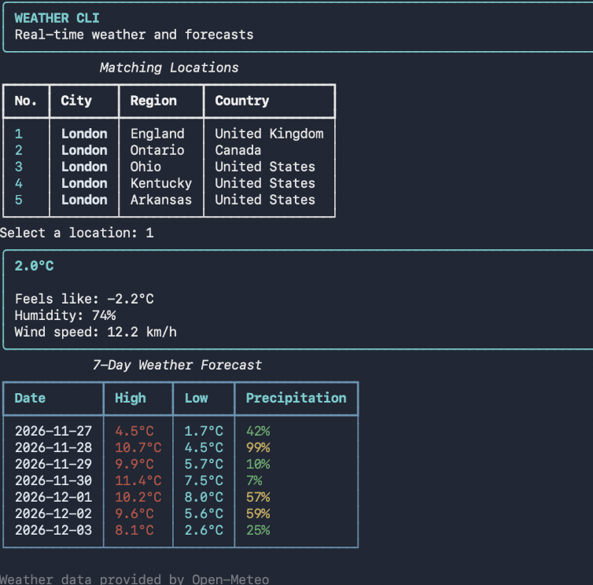
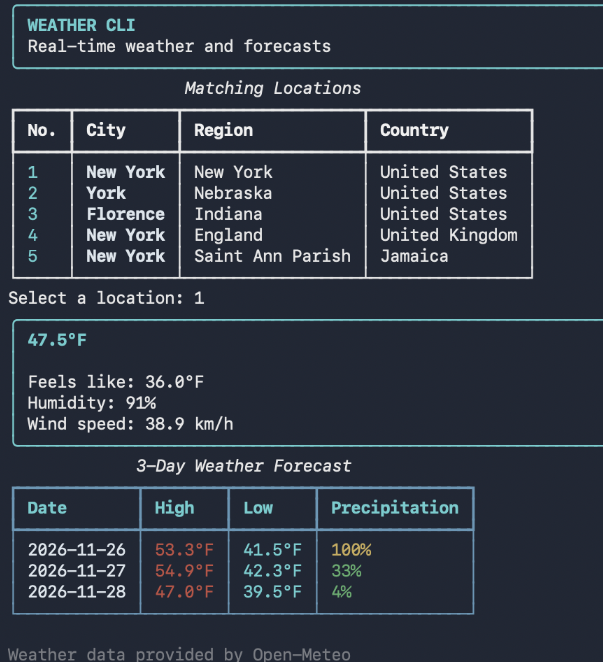
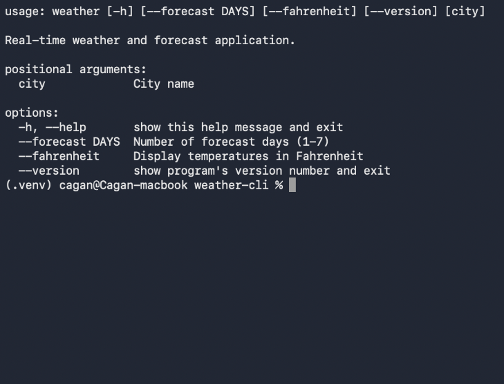
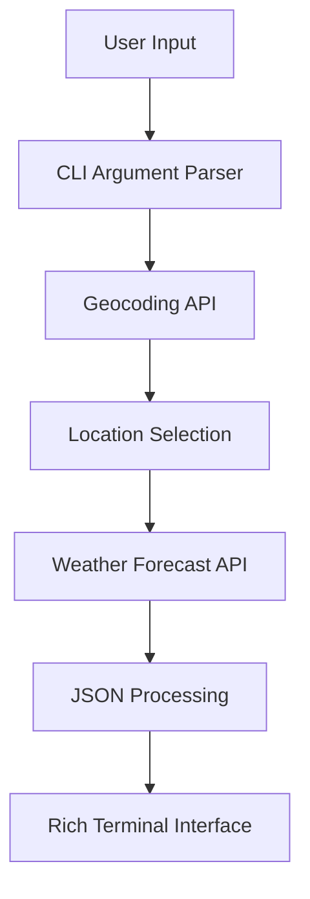

# Weather CLI

A Python-based command-line application that provides
real-time weather information and customizable forecasts
directly in your terminal.


## Overview

Weather CLI combines geocoding and weather APIs to deliver
weather information through a modern, interactive
terminal interface.

No API key is required.

## Preview

### Current Weather and 7-Day Forecast



### Fahrenheit and Custom Forecast Duration



### Command-Line Interface



## Features

- Real-time weather information
- Interactive location selection
- Worldwide city search
- Customizable forecasts from 1 to 7 days
- Celsius and Fahrenheit support
- Temperature, humidity and wind speed
- Daily precipitation probability
- Colorful terminal interface
- Network error and timeout handling
- Installable command-line application

## Installation

### Requirements

- Python 3.10 or later
- Git
- Internet connection

### Clone the repository

```bash
git clone https://github.com/cgnerdogan/weather-cli.git
cd weather-cli
```

### Create a virtual environment

```bash
python3 -m venv .venv
```

Activate on macOS or Linux:

```bash
source .venv/bin/activate
```

Activate on Windows PowerShell:

```powershell
.venv\Scripts\Activate.ps1
```

### Install the application

```bash
pip install -e .
```

## Usage

Search for a city:

```bash
weather London
```

Display a three-day forecast:

```bash
weather London --forecast 3
```

Display temperatures in Fahrenheit:

```bash
weather "New York" --fahrenheit
```

Combine multiple options:

```bash
weather London --forecast 5 --fahrenheit
```

Display available commands:

```bash
weather --help
```

Display the current version:

```bash
weather --version
```

## Architecture



## Technologies

| Technology | Purpose |
|---|---|
| Python | Core application development |
| Requests | HTTP requests and API communication |
| Open-Meteo | Geocoding and weather data |
| Rich | Terminal interface and formatting |
| Argparse | Command-line argument parsing |
| Setuptools | Python packaging |
| Git | Version control |
| GitHub | Repository hosting and collaboration |

## Development History

This project was developed incrementally, with each major
feature recorded through Git commits and version tags.

| Version | Milestone |
|---|---|
| v0.1.0 | Initial weather API integration |
| v0.2.0 | Error handling and interactive city selection |
| v0.3.0 | Seven-day weather forecasts |
| v0.4.0 | Rich terminal interface |
| v0.5.0 | CLI arguments and Python packaging |
| v1.0.0 | First public release |

Historical version tags represent development milestones
and were assigned retrospectively.

For more details, see the [Changelog](CHANGELOG.md).

## Future Roadmap

- AI-powered weather recommendations
- Improved city search
- Saved favorite locations
- Hourly weather forecasts
- Automated testing and continuous integration

## Data Source

Weather and geocoding data are provided by
[Open-Meteo](https://open-meteo.com/).

Weather forecasts are estimates and should not be used
as a substitute for official severe weather warnings.

## Author

Developed by [Cagan Erdogan](https://github.com/cgnerdogan).
